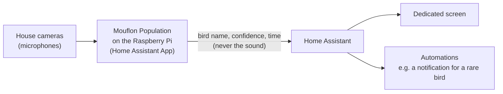

# Mouflon Population

Mouflon Population listens to the birds around the house and tells Home Assistant which ones it hears.

It uses **BirdNET**, a bird-sound recognition model from the Cornell Lab of Ornithology and Chemnitz University of Technology, and runs on a **Raspberry Pi inside Home Assistant**, listening first to the microphones of outdoor battery cameras (a proof of concept; the sound source can be swapped later, for example for a dedicated microphone). Detections ("Merle noir, 87 % sure, Camera 1, 07:42") appear in Home Assistant, with a vintage drawing of each bird, and on a demo e-ink screen.

**New here?** Start with [CONTRIBUTING.md](CONTRIBUTING.md): what to read first, how to run the tests, where things are.

## Status

| | |
|---|---|
| Stage | **Proof of concept** (App version 0.6.1, see [app/CHANGELOG.md](app/CHANGELOG.md)): demo mode, bird library of vintage drawings, rarity, e-ink demo screen, analytics table; real listening waits for the cameras' sound |
| Architecture | Approved by the owner on 2026-11-21: [docs/architecture](docs/architecture/README.md) |
| Next | Real listening with the battery cameras, watching their battery |
| Tracking | Jira project MOUL |
| Security | Threat model and review: [docs/security.md](docs/security.md) |
| Tests | [docs/testing.md](docs/testing.md): unit tests, real BirdNET tests, and an end-to-end test with a real Home Assistant |
| Preview | [docs/preview/index.html](docs/preview/index.html): the detections page, from sample data |
| How to install | [docs/install.md](docs/install.md) · user guide shown in Home Assistant: [app/DOCS.md](app/DOCS.md) |
| Demo mode | Fake, clearly marked bird detections to preview Home Assistant before the microphone works |
| E-ink screen | [docs/screen-preview/preview.html](docs/screen-preview/preview.html): the demo screen, from sample data |
| Home Assistant dashboard | Reference copy: [docs/home-assistant/](docs/home-assistant/birds-dashboard.yaml) |
| Runs in production | Nothing yet |

## How it works

- Everything happens **in the house**: the sound is analysed in memory, 3 seconds at a time, and is never saved or sent anywhere. **No audio is ever kept**: only a log of the birds detected (species, confidence, source, time).
- Only bird detections reach Home Assistant. Human voices are ignored.
- Preview pages let us check the result without a Raspberry Pi.

## Installing on the Raspberry Pi

The repository stays **private**. Home Assistant reads it with a **read-only GitHub token that the owner creates and pastes themselves**. Nobody else ever sees or stores it.

- **Token:** fine-grained, **only** this repository, **Contents: read-only**, with an **expiry date**.
- **Repository address** in Home Assistant (Settings → Apps → App store → ⋮ → Repositories): `https://x-access-token:<TOKEN>@github.com/<OWNER>/<REPOSITORY>#staging`. Keep the `x-access-token:` part: the shorter form without it fails on Home Assistant ("could not read Username"). `<OWNER>/<REPOSITORY>` is the repository's address on GitHub and `<TOKEN>` is a placeholder for the token; never put a real token in a file or a chat.
- Then install **Mouflon Population** from the App store. Step-by-step instructions: [docs/install.md](docs/install.md); settings for household users: [app/DOCS.md](app/DOCS.md).

## Where it comes from

This repository started as a copy of [BirdNET-Analyzer](https://github.com/birdnet-team/BirdNET-Analyzer) by the BirdNET team (K. Lisa Yang Center for Conservation Bioacoustics at the Cornell Lab of Ornithology, and Chemnitz University of Technology). Details of the import: [UPSTREAM.md](UPSTREAM.md). The original project's README is kept in [docs/upstream-README.md](docs/upstream-README.md). All credit for the bird recognition goes to them — see https://birdnet.cornell.edu.

## Licences

- **Code:** MIT licence, copyright the BirdNET team ([LICENSE](LICENSE)). Our own additions are under the same licence.
- **BirdNET 2.4 and geo models:** Creative Commons BY-NC-SA 4.0 — **non-commercial use only**. Mouflon Population is a personal, non-commercial project, so this is fine. Personal use at home, research and education are fine; any commercial use (including under a company) needs an agreement with the BirdNET team.
- **BirdNET 3.0 acoustic model:** Apache 2.0, with the BirdNET team's acceptable use policy.

## For developers

Rules and technical notes for anyone (human or AI agent) working on the code: [AGENTS.md](AGENTS.md). All documentation: [docs/README.md](docs/README.md). Report security problems privately: [SECURITY.md](SECURITY.md).
