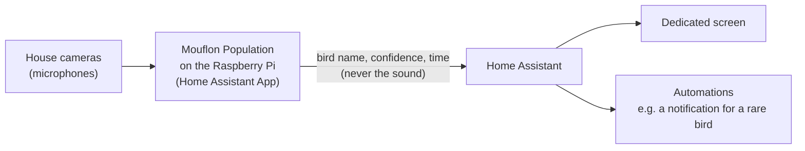
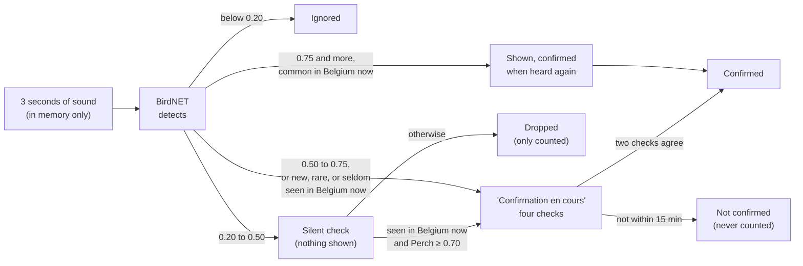

# Mouflon Population

Mouflon Population listens to the birds around the house and tells Home Assistant which ones it hears.

It uses **BirdNET**, a bird-sound recognition model from the Cornell Lab of Ornithology and Chemnitz University of Technology, to detect the birds. Uncertain or rare birds show **"Confirmation en cours"** and are **cross-checked** by a second model, **Perch 2.0 from Google DeepMind**, and by **Belgian bird observation statistics from GBIF** before they count. It all runs on a **Raspberry Pi inside Home Assistant**, listening first to the microphones of outdoor battery cameras (a proof of concept; the sound source can be swapped later, for example for a dedicated microphone). Detections ("Merle noir, 87 % sure, Camera 1, 07:42") appear in Home Assistant, with a vintage drawing of each bird, and on a demo e-ink screen.

**New here?** Start with [CONTRIBUTING.md](CONTRIBUTING.md): the secrets and keys you must set yourself, what to read first, how to run the tests, where things are.

## Status

| | |
|---|---|
| Stage | **Proof of concept** (App version 0.7.0, see [app/CHANGELOG.md](app/CHANGELOG.md)): demo mode, bird library of vintage drawings, rarity, confirmation with cross-checks (Perch, GBIF), e-ink demo screen, analytics table; real listening waits for the cameras' sound |
| Architecture | Approved by the owner on 2026-11-21: [docs/architecture](docs/architecture/README.md) |
| Next | Real listening with the battery cameras, watching their battery |
| Tracking | Jira project MOUL |
| Security | Threat model and review: [docs/security.md](docs/security.md) |
| Tests | [docs/testing.md](docs/testing.md): unit tests, real BirdNET tests, and an end-to-end test with a real Home Assistant |
| Preview | [docs/preview/index.html](docs/preview/index.html): the detections page, from sample data |
| How to install | [docs/install.md](docs/install.md) · user guide shown in Home Assistant: [app/DOCS.md](app/DOCS.md) |
| Demo mode | Fake, clearly marked bird detections to preview Home Assistant before the microphone works |
| E-ink screen | [docs/screen-preview/preview.html](docs/screen-preview/preview.html): the demo screen, from sample data |
| Home Assistant dashboard | Reference copy: [docs/home-assistant/](docs/home-assistant/birds-dashboard.yaml) |
| Runs in production | Nothing yet |

## How it works

- Everything happens **in the house**: the sound is analysed in memory, 3 seconds at a time, and is never saved or sent anywhere. **No audio is ever kept**: only a log of the birds detected (species, confidence, source, time).
- Only bird detections reach Home Assistant. Human voices are ignored.

### How a bird is confirmed

**BirdNET detects, with a score.** The score decides what happens next:

| BirdNET score | What happens |
|---|---|
| Below 0.20 | Ignored. |
| 0.20 to 0.50: **silent check** | Nothing is shown. In the background, the App checks whether the species is regularly observed in Belgium this week (GBIF) and asks Perch. The bird is published only if both agree (Perch at 0.70 or more); it then shows "Confirmation en cours" (Confirmation in progress) and needs one more check. Otherwise it is dropped. Only a counter is shown: "Oiseaux rattrapés par la vérification silencieuse" (birds rescued by the silent check), with the number rejected. |
| 0.50 to 0.75: **unsure** | Shown at once as **"Confirmation en cours"** and cross-checked (below). |
| 0.75 and more, for a bird common in Belgium this week and not new or rare for the garden | Shown at once, confirmed when heard a second time. Perch is not asked, to spare the Pi. |
| Any score, for a bird **new or rare** for the garden, unusual, threatened, or **seldom observed in Belgium** this week | Always cross-checked. |

**The cross-checks.** A bird in "Confirmation en cours" is confirmed as soon as **two of four checks** agree:
1. BirdNET is sure (0.75 or more);
2. the bird is heard again within 15 minutes;
3. **Perch 2.0** (Google DeepMind) listens to the same 3 seconds, still in memory, and hears the same species (Perch score 0.70 or more, calibrated on a test recording; to be re-tuned with garden data);
4. **GBIF statistics** show the species is regularly observed in Belgium at this time of year. They are bundled in the App and never looked up online.

So a bird seldom observed locally needs Perch to agree or to be heard twice. A check that cannot run (for example when the Pi is busy) is skipped and never blocks. A bird not confirmed within 15 minutes is withdrawn and never counted.

**Sparing the Pi.** Perch runs at most 6 times a minute. Silent checks come last: they are skipped first when the Pi is busy.

**Tuning.** Every threshold is a setting with a French label (0.20, 0.50, 0.75, and Perch's 0.70). BirdNET's score is not a true probability, so these are starting values. They should be tuned once the analytics table and the silent-check counter hold a few weeks of real garden data.

## Installing on the Raspberry Pi

The repository stays **private**. Home Assistant reads it with a **read-only GitHub token that the owner creates and pastes themselves**. Nobody else ever sees or stores it.

- **Token:** fine-grained, **only** this repository, **Contents: read-only**, with an **expiry date**.
- **Repository address** in Home Assistant (Settings → Apps → App store → ⋮ → Repositories): `https://x-access-token:<TOKEN>@github.com/<OWNER>/<REPOSITORY>#staging`. Keep the `x-access-token:` part: the shorter form without it fails on Home Assistant ("could not read Username"). `<OWNER>/<REPOSITORY>` is the repository's address on GitHub and `<TOKEN>` is a placeholder for the token; never put a real token in a file or a chat.
- Then install **Mouflon Population** from the App store. Step-by-step instructions: [docs/install.md](docs/install.md); settings for household users: [app/DOCS.md](app/DOCS.md).

## Where it comes from

This repository started as a copy of [BirdNET-Analyzer](https://github.com/birdnet-team/BirdNET-Analyzer) by the BirdNET team (K. Lisa Yang Center for Conservation Bioacoustics at the Cornell Lab of Ornithology, and Chemnitz University of Technology). Details of the import: [UPSTREAM.md](UPSTREAM.md). The original project's README is kept in [docs/upstream-README.md](docs/upstream-README.md). All credit for the bird recognition goes to them — see https://birdnet.cornell.edu. The second opinion comes from Google DeepMind's Perch 2.0, and the local observation statistics from GBIF (Global Biodiversity Information Facility) and the organisations that publish Belgian bird records there.

## Licences

- **Code:** MIT licence, copyright the BirdNET team ([LICENSE](LICENSE)). Our own additions are under the same licence.
- **BirdNET 2.4 and geo models:** Creative Commons BY-NC-SA 4.0 — **non-commercial use only**. Mouflon Population is a personal, non-commercial project, so this is fine. Personal use at home, research and education are fine; any commercial use (including under a company) needs an agreement with the BirdNET team.
- **BirdNET 3.0 acoustic model:** Apache 2.0, with the BirdNET team's acceptable use policy.
- **Perch 2.0** (second opinion): model by Google DeepMind, Apache 2.0. We use an ONNX conversion of it (also Apache 2.0), downloaded when the App is built and checked against a fixed fingerprint. Reference: Perch 2.0, Google DeepMind, 2025 — https://github.com/google-research/perch.
- **GBIF bird observation statistics** (local check): weekly counts for Belgium computed from GBIF.org records, using only records licensed **CC0 1.0** or **CC BY 4.0** (7.45 million records, 2016–2025). Every dataset is cited with its DOI in [app/crosscheck/manifest.json](app/crosscheck/manifest.json). Data accessed via GBIF.org; thanks to the observers and publishers, notably Natuurpunt (Waarnemingen.be) and the Research Institute for Nature and Forest (INBO).

## For developers

Rules and technical notes for anyone (human or AI agent) working on the code: [AGENTS.md](AGENTS.md). All documentation: [docs/README.md](docs/README.md). Report security problems privately: [SECURITY.md](SECURITY.md).
