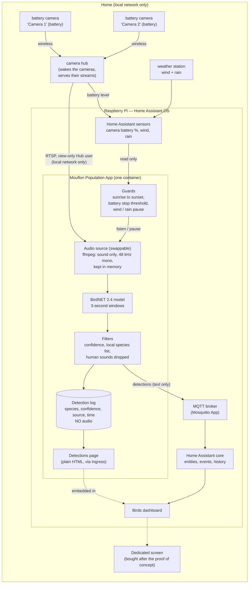
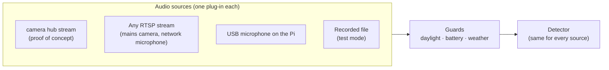
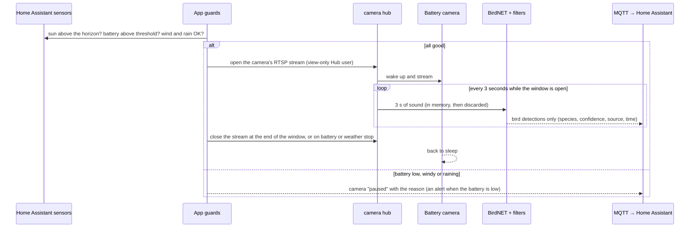
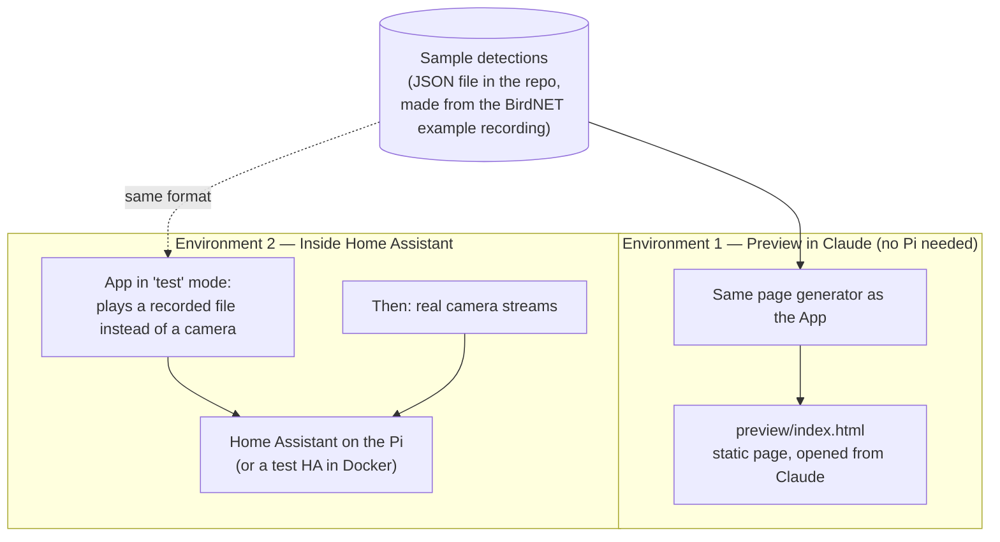
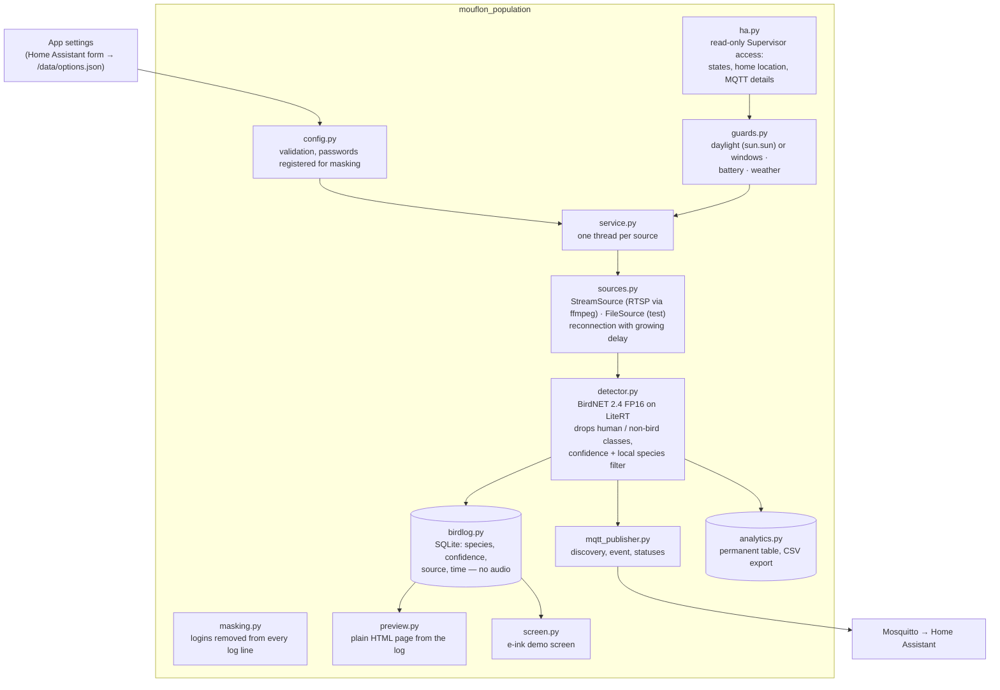
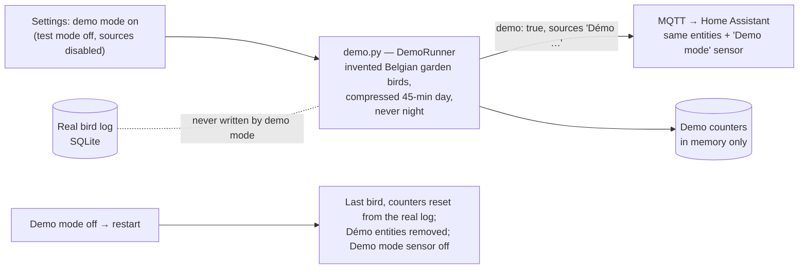
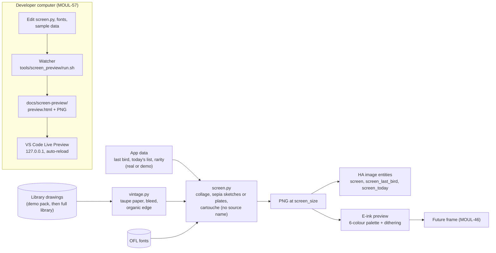
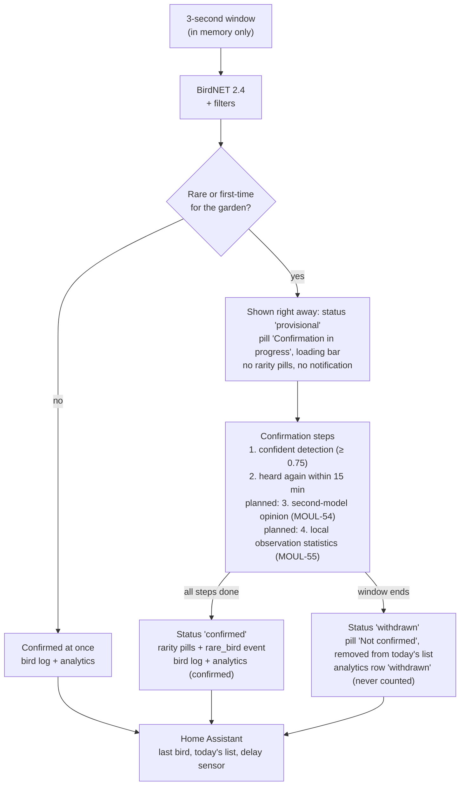

# Architecture — Mouflon Population

Status: **approved by the owner on 2026-11-21** (sprint zero "takeover + architecture" closed). Updated the same day with the owner's answers and the facts from the owner's Home Assistant. Jira: epic MOUL-4. Changes from now on need an architecture decision recorded in a work file.
Owner: architect. Threat model: [`../security.md`](../security.md). Work files are internal and not included in this copy (see [`../work/README.md`](../work/README.md)).

Nothing in this page is built yet. It describes what we propose to build next, so the owner can say yes, no or "change this" before any code is written.

## 1. In one paragraph

A small program, the **detector**, runs on the Raspberry Pi next to Home Assistant, as a Home Assistant **App** (the new name, since Home Assistant 2026.2, for what used to be called an "add-on"). It listens to the sound of the two outdoor battery cameras (as a proof of concept, see §3.2), cuts it into 3-second pieces, asks the BirdNET model "is there a bird, and which one?", and only tells Home Assistant the answer ("Eurasian Blackbird, 87 % sure, Camera 2, 07:42"). The sound itself is never saved and never leaves the house. Home Assistant turns each answer into normal Home Assistant entities and events, so a dashboard on a dedicated screen can show the birds and automations can react to them. The same program can also turn a list of detections into a simple web page, which is how we preview it here in Claude without a Raspberry Pi.

### Firm rule: no audio is kept

**Decided by the owner on 2026-11-21: no sound is ever kept.** The App holds 3 seconds of sound in memory at a time, analyses it and drops it. It never writes sound to disk, logs, history, backups or messages, and never sends it anywhere. The only thing kept is the **log of detected birds**: species, confidence, source, and time. There are no bird clips and no "replay the song" feature. Changing this rule would need a new decision by the owner and a new security review.

## 2. The big picture

## 3. Decisions and the options we compared

### 3.1 How it is packaged on the Pi

| Option | What it means | For | Against |
|---|---|---|---|
| **A. Home Assistant App (recommended)** | Our own container, installed and updated from Home Assistant's "Apps" page, managed by the Supervisor | One-click install/update/backup from Home Assistant; settings form in the HA interface; secrets stored by HA; Ingress gives a page inside HA without opening a port; can be limited to the Pi's own network | Needs Home Assistant OS or Supervised (to confirm, see open questions); a container image to build for arm64 |
| B. Custom integration (Python code inside Home Assistant itself) | Our code runs inside the Home Assistant process | No separate container | BirdNET needs heavy maths libraries (ONNX Runtime / LiteRT, numpy, librosa) that would have to live inside Home Assistant's own Python and can clash with it; continuous audio analysis would compete with Home Assistant on the same process and could slow or crash it; harder to test outside HA. **Rejected.** |
| C. Separate container next to HA (Docker Compose) | Same container as A, started by hand | Works if Home Assistant is the "Container" install type (no Apps page) | Updates, backups and settings by hand; needs an MQTT login written in a file |

**Decision (proposed):** build **one container image** that is published to Home Assistant as an **App (A)**. Because it is a normal container, option C comes for free as a fallback and as our test setup. Option B is rejected for stability and dependency reasons.

### 3.2 How the sound gets in (cameras) — proof of concept

**Proof-of-concept setup:** two outdoor **battery cameras** that connect through a **camera hub**, which is already linked to Home Assistant. There are no indoor cameras in Home Assistant.

**Decision (owner):** use these two cameras, through the camera hub, as a **proof of concept** (Jira MOUL-37), with the audio source kept swappable (MOUL-13).

**The catch: battery cameras sleep.** They only stream when something wakes them (motion, the app, or a stream request through the hub). Listening continuously keeps them awake and drains the battery, possibly in days. So the proof of concept is designed around the battery:

- **Stream path (as built, decision 2026-11-21 in the build sprint):** the App reads each camera's stream **directly from the camera hub over RTSP**, on the local network, with a **separate view-only Hub user** that the owner creates and whose password the owner types into the App's settings themselves. The first design went through Home Assistant's built-in go2rtc, but that go2rtc only listens inside Home Assistant and names its streams internally, so an App cannot rely on it. The Hub login is stored by Home Assistant with the App's settings, masked in every log line and never in the repository. ffmpeg keeps the sound only, 48 kHz mono, in memory, in 3-second pieces. **Nothing is written to disk.** First step of MOUL-37: check that the hub's RTSP option is on and that the sound track is present.
- **Continuous listening during the day (owner's decision, 2026-11-21, MOUL-39):** by default the App listens **continuously from sunrise to sunset**, using Home Assistant's sun entity (`sun.sun`). If the sun's position cannot be read, it does not listen. Fixed listening windows (for example 05:30–08:30 and 18:00–20:00) and "always" remain available as settings. This drains the battery faster than the first proposal, so the battery guard below will act more often. Each camera's status then says **"paused: battery …"** with the reason.
- **Battery guard with a stop threshold:** the App reads each camera's battery level from Home Assistant (the camera integration provides it). Below the **stop threshold** (proposal: 40 %), the App stops waking that camera and raises an alert in Home Assistant. It resumes only above a restart level (proposal: 60 %, after charging). It also stops if the battery falls faster than a set rate (proposal: more than 15 points per day).
- **Weather guard:** the App reads wind speed and rain from the weather station already in Home Assistant. When it is windy (proposal: gusts above 25 km/h) or raining, it pauses. Wind and rain noise cause false detections, birds sing less, and the battery is spared.
- **Measuring the drain:** during the proof of concept, a small Home Assistant history chart tracks battery % per camera against listening minutes. **Exit criterion** (to agree with the owner): if keeping the windows above costs more than about one recharge a month, or the cameras' motion recording suffers, we switch source.
- **If the drain is too heavy, switch source** (decision in MOUL-13). The candidates, in order of simplicity:
  1. a **dedicated outdoor microphone**, either USB on the Pi or a small network microphone streaming over RTSP. It is always on, needs no battery and gives the best sound.
  2. a **mains-powered camera** with a microphone, which streams continuously.
  3. a solar panel for the battery cameras, which reduces the drain but does not remove it.

**Swappable source, by design.** The App talks to one simple "audio source" interface: *give me the next 3 seconds of sound*, plus *are you available?*. Each kind of source is one small plug-in:

Changing the source is a setting in the App's form, not a rewrite. The battery guard only applies to battery sources.

### 3.3 How detections become Home Assistant things

**Decision (proposed): MQTT with Home Assistant "MQTT discovery".** The App publishes small text messages; Home Assistant creates the entities by itself. This is the standard way local devices talk to Home Assistant, it works the same for option A and C, and it keeps the App and Home Assistant loosely coupled (either can restart without breaking the other). **The owner approved the Mosquitto App** (none installed yet; set-up in MOUL-23). The App gets the broker's address and its own login **automatically from the Supervisor** (the Mosquitto App shares them with Apps that ask), so the owner does not type an MQTT login into this App. Separately, the App **reads** a few Home Assistant states (camera battery, wind, rain, home location, sun times) through the Supervisor-provided access, with no long-lived token.

Entities created (one device "Mouflon Population", plus one per camera):

| Entity | Example value | Use |
|---|---|---|
| `event.mouflon_population_bird_detected` | event with species, scientific name, confidence, source, time | Automations ("notify me when a woodpecker is heard"), logbook |
| `sensor.mouflon_population_last_bird` | "Eurasian Blackbird" (+ details as attributes) | Dashboard |
| `sensor.mouflon_population_species_today` | 14 (number of different species today) | Dashboard |
| `sensor.mouflon_population_detections_today` | 132 | Dashboard |
| `binary_sensor.mouflon_population_<camera>_listening` | on / off | Shows whether a camera is being listened to |
| `sensor.mouflon_population_<camera>_status` | listening / paused: battery / paused: weather / outside window / offline | Explains why a camera is not listened to |

What is **never** sent or stored (firm rule above): sound, human-related classes (BirdNET has "Human vocal", "Human whistle" and similar labels — they are dropped inside the App), the camera addresses or passwords.

### 3.4 The dedicated screen

**Decision (owner): the screen will be bought after the proof of concept. No screen work is planned before then.** Until the device is chosen, the design stays device-agnostic. Anything that can show a Home Assistant dashboard in a browser will work: a tablet, a small HDMI display on the Pi, or a touch display.

What the screen will show is already decided, and it needs no special hardware:

1. **A "Birds" dashboard in Home Assistant**, made only of standard cards fed by the entities above. No code.
2. **The App's own "Detections" page**: plain HTML from the App's history, reachable inside Home Assistant through Ingress (no extra port), and embeddable in the dashboard.
3. Kiosk mode on whichever device is bought.

During the proof of concept, the owner sees the detections in the normal Home Assistant app on a phone or computer. The designer is only needed when the owner wants the screen to look nice (Liquid Glass).

### 3.5 The two test environments

- **Preview (environment 1):** a sample detections file is committed to the repo; the same code the App uses to draw its Detections page turns it into a static HTML page. Every change can be looked at here in Claude without a Pi, a camera or a model download.
- **Inside Home Assistant (environment 2):** the App has a "test" setting (the *recorded file* source) that replays a recorded sound file (the BirdNET example recording) as if it were a camera — so the whole chain can be checked without waking the battery cameras — so Home Assistant gets real detections without anyone near a microphone. Once that works, switch to the real cameras. For automated tests we can also start Home Assistant + Mosquitto in Docker on GitHub's servers and check the entities appear.
- The automated test suite keeps running on every push to `staging` (ruff + pytest + dependency audit).

### 3.6 Fitting on the Raspberry Pi

**Target hardware:** a **Raspberry Pi** running Home Assistant OS, with enough memory for Home Assistant, its other Apps and the budget below.

| Item | Budget we design for | Why |
|---|---|---|
| Memory used by the App | ≤ 1 GB | Home Assistant and its other Apps (including Mosquitto) need roughly 1.5–2 GB |
| Processor | ≤ 1 of the 4 cores on average for 2 cameras | Real time means analysing 3 s of sound in well under 3 s per camera; no listening at night halves the average |
| Disk | ≤ 1 GB (model + history), no audio stored | Limits SD card / SSD wear |

Which BirdNET model:

| Model | Size | Runs with | Licence | Fit for the Raspberry Pi |
|---|---|---|---|---|
| **BirdNET 2.4, TFLite FP16 (chosen to start)** | tens of MB | LiteRT (small, no full TensorFlow) | CC BY-NC-SA 4.0, non-commercial: **OK, the owner confirmed personal non-commercial use** | Light, proven on Raspberry Pis |
| BirdNET 3.0, ONNX FP32 (upstream default) | ~345 MB | ONNX Runtime (has arm64 builds) | Apache 2.0 + acceptable use policy | Fits on a Raspberry Pi with enough memory; newer and likely more accurate but ~3× heavier — candidate after the benchmark |
| Perch v2 | ~380 MB | TensorFlow | — | Not considered |

**Decision:** start with **BirdNET 2.4 TFLite FP16** through LiteRT. The benchmark on the Pi (MOUL-12) then decides whether 3.0 becomes the default; with enough memory, it is not the limit, so the decision is about speed and accuracy. The geo model ("which species live here this week") filters the species list using **Home Assistant's home location**, which **The owner approved**. The location is read on the Pi and never leaves it.

The App image must **not** contain TensorFlow, the training tools or the desktop interface: they are what makes the upstream image several gigabytes (MOUL-5).

#### Licence

The owner confirmed (2026-11-21) that Mouflon Population stays a **personal, non-commercial project**, not run under a company. That makes the BirdNET 2.4 and geo models (CC BY-NC-SA 4.0) usable. If this ever changes, the models need a new licence review before any commercial use.

### 3.7 What we keep and drop from the imported code

| Part of BirdNET-Analyzer | Decision | When |
|---|---|---|
| `analyze/`, `model_utils.py`, `audio.py`, `config.py`, `utils.py`, `logs.py` | **Keep** — the heart of the detector (we will add a "stream" mode next to the "files" mode) | — |
| `species/` + geo model | **Keep** — local species list | — |
| Example recording `birdnet_analyzer/example/` | **Keep** — used by the preview and the HA test mode | — |
| Test data submodule `tests/data` | **Keep** | — |
| `gui/` (desktop app, Gradio + pywebview) and `lang/` | **Drop** from the Pi image now (security finding: it can serve any file of the machine); remove from the repo once the stream mode works | Next sprint |
| `train/`, `embeddings/`, `search/`, `segments/`, `evaluation/` | **Drop** from the Pi image; keep in the repo for now (useful if the owner later trains a model on recordings of the garden) | Decide later |
| Upstream Sphinx docs `docs/*.rst`, `docs/_static` (28 MB, incl. audio guides) | Keep for now as reference; remove later | Decide later |
| Release workflows (PyPI, winget, Linux packages, docs site) | **Removed now** — they publish under the BirdNET team's names | Done this sprint |

### 3.8 Team stack rule (React + Redux, Hono on Cloudflare Workers)

**Decision: the standard web stack does not apply to this product, by design.**

- The product runs **on the Pi, inside the house, offline**. Cloudflare Workers would mean sending private household sound (or at least detections) out of the house — the threat model forbids the sound, and there is no need for the detections.
- BirdNET and its maths libraries are **Python**; rewriting the analysis in TypeScript is not realistic.
- The only screen is a Home Assistant dashboard plus one plain HTML page. A React + Redux front end would add a build chain for a page with a list on it — over-engineering.
- **Where the standard would come back:** if the owner later wants a rich interactive bird site (statistics, photos, sharing outside the house), that site would follow the standard stack (React + Redux, Hono on Cloudflare Workers), reading only anonymised detections that the owner chooses to publish. That would be a new architecture sprint.

- **No Cloudflare (confirmed by the owner, 2026-11-21).** This project does not use Cloudflare for now: everything runs locally on the Pi. When the owner wants to look at the detections away from home, the owner uses the **existing Home Assistant Cloud** remote access, which shows the same Home Assistant dashboard and Detections page behind the owner's Home Assistant login. The project adds no new cloud service, and sound never goes through it (there is none to send: no audio is kept).

Stack for this product: Python 3.13 (upstream code), ffmpeg, LiteRT / ONNX Runtime, SQLite, MQTT, Home Assistant App packaging (Docker, arm64).

## 4. The App's inside (as built, version 0.1.0)

The App lives in `app/` (the Home Assistant App folder) with its Python package in `app/src/mouflon_population/`. It uses the `birdnet` library directly, **not** the imported `birdnet_analyzer` package (which would pull in TensorFlow).

| Piece | Jira | Notes |
|---|---|---|
| Image without desktop UI, training tools, TensorFlow | MOUL-14 | Checked in CI: `tensorflow`, `gradio`, `webview`, `birdnet_analyzer` cannot be imported in the image |
| Pinned base images, no admin rights | MOUL-15 | Base image by digest; the App drops to an unprivileged user with no capabilities |
| Model fingerprints | MOUL-16 | `app/models.lock.json`; the image build fails if a model file differs |
| Lock file | MOUL-17 | `app/requirements.lock`, every package hash-checked |
| Stream reader with reconnection | MOUL-19 | Delay doubles from 2 s up to 2 min |
| Replay-file test mode | MOUL-20 | Bundled 60 s excerpt of the BirdNET example recording |
| Credentials masked | MOUL-21 | Logins in URLs and every registered password are replaced by `***` |
| Human voices discarded | MOUL-25 | Plus every non-species class (dog, engine, siren…) |
| MQTT discovery entities, bird event | MOUL-23, MOUL-24 | Entity ids in §3.3 |
| Species filter | MOUL-26, MOUL-40 | Geo model 2.4, home location, BirdNET week; refreshed daily. **Off in test mode** (the test recording is North American); every drop is counted in the log |
| Bird log | MOUL-28 | Retention 365 days by default |
| Daylight listening | MOUL-39 | Sunrise to sunset from `sun.sun` (default); windows or always as settings; unknown sun = no listening |
| Battery watch | MOUL-37 | Stop below 40 %, resume above 60 %, max 15 %/day, unknown or older than 6 h = no listening |
| App packaging | MOUL-18 | `repository.yaml` + `app/config.yaml`; built on the Pi, nothing published |
| Preview page | MOUL-31 | `docs/preview/index.html` from `app/samples/detections.json` (sample data) |
| Demo mode | MOUL-41 | `demo.py`; fake data marked everywhere, never in the bird log |
| HA + Mosquitto in CI | MOUL-32 | "App image" workflow: real Home Assistant 2026.8.1, Mosquitto and the App in test mode |

**Demo mode (MOUL-41, version 0.1.2).** Until the cameras' sound works, a separate mode fills Home Assistant with invented detections of common Belgian garden birds. It uses no audio and no model. **It is never night in demo mode (MOUL-50, version 0.1.3):** activity runs on a compressed 45-minute "day" with a busy dawn wave, a quieter middle and a busy dusk wave, and never drops below 20 % of the peak, whatever the real sun. Real listening keeps following sunrise to sunset. It runs instead of the listening service, never alongside it, and the settings refuse demo mode together with test mode or enabled sources.

The reference Home Assistant dashboard is in `docs/home-assistant/` (see `docs/install.md`).

**Installing on the Pi.** The repository **stays private (owner's decision, 2026-11-21)**. Home Assistant reads it with a **fine-grained, read-only GitHub token that the owner creates and pastes themselves**. The token is limited to this repository, with *Contents: read-only* and an expiry date. The repository address the owner adds in Home Assistant has the form `https://x-access-token:<TOKEN>@github.com/<OWNER>/<REPOSITORY>#staging`, where `<OWNER>/<REPOSITORY>` is the repository's address on GitHub and `<TOKEN>` is a placeholder (the form without `x-access-token:` failed on the real Home Assistant); the `#staging` part keeps it on the staging branch. The steps are in `docs/install.md`. The Supervisor then builds the image on the Pi from `app/Dockerfile`, and nothing is published to any registry.

## 5. Questions for the owner

**All of the owner's open questions are answered, and the owner signed off the architecture on 2026-11-21 (MOUL-4 / MOUL-11).**

### For the proof of concept (to agree when it starts, MOUL-37)

- The battery stop threshold, restart level and maximum drain per day (proposals: 40 %, 60 %, 15 points per day), and the listening schedule. **Decided 2026-11-21: continuous from sunrise to sunset** (MOUL-39).
- The exit criterion that triggers switching source (proposal: more than about one recharge a month).

### Answered (2026-11-21)

| Question | Answer |
|---|---|
| Which Raspberry Pi? | A Raspberry Pi with enough memory for the chosen model |
| How is Home Assistant installed? | Home Assistant OS (Apps available) |
| MQTT broker? | None yet; Mosquitto App approved, the owner sets the login themselves (MOUL-23) |
| Which cameras? | Two outdoor battery cameras behind a camera hub; used as a proof of concept |
| Indoor cameras? | Indoor sources stay excluded by default |
| Commercial use? | No: personal, non-commercial, so the 2.4 licence is fine |
| Dedicated screen? | Bought after the proof of concept; design stays device-agnostic; no screen work before then |
| Home location for the species filter? | Yes |
| Keep short bird clips? | **No.** No audio is kept; only the detection log (species, confidence, source, time). Now a firm rule |
| Weather | A weather station's wind and rain sensors, when available, pause listening |

## 6. Jira

Project **MOUL** (). Epics: MOUL-4 Architecture sign-off, MOUL-5 Slim Pi App image, MOUL-6 Audio intake, MOUL-7 Detections into Home Assistant, MOUL-8 Detections page and screen, MOUL-9 Test environments, MOUL-10 Cleanup. Key stories: MOUL-11 open questions, MOUL-12 model benchmark, MOUL-13 audio source decision, MOUL-37 battery-camera proof of concept, MOUL-14 security finding H1, MOUL-23 Mosquitto.

## 7. Illustrated bird library, rarity and reference songs (epic MOUL-42, MOUL-47, MOUL-48; version 0.2.0)

Every bird is shown with a 19th-century hand-coloured plate, tagged by rarity, and can play a **reference song of its species**. Everything is prepared in GitHub Actions and bundled in the App: **the Pi never fetches anything from the internet**.

```mermaid
flowchart LR
  subgraph CI["GitHub Actions — 'Bird illustrations' workflow (manual / on change)"]
    geo["Geo model 2.4<br/>Belgian species over a year"] --> wd["Wikidata (CC0)<br/>synonyms, IUCN status"]
    wd --> commons["Wikimedia Commons<br/>Naumann plates (PD), Dresser as fallback"]
    cache[("Plate cache<br/>from earlier runs")] -. "reused if checksum matches" .-> commons
    commons -- "busy: retry with backoff,<br/>else 'failed, retry later'" --> build["Clean crops (crops.json),<br/>paper tone kept, HA + e-ink sizes,<br/>contact sheet + coverage"]
    build -- "saved even when the run<br/>stops 15 min before its limit" --> review[("library-build branch<br/>build/ + demo-pack/")]
    geo --> xc["xeno-canto<br/>reference songs (CC BY / BY-SA / BY-NC)"]
    xc --> clips["15 s clips, normalised"]
  end
  review -- "install.py after the owner's approval<br/>(full build; demo pack only fills gaps)" --> lib[("app/library/<br/>catalogue.json, images/, songs/")]
  clips --> lib
  lib --> app["App on the Pi"]
  app -- "image entities over MQTT" --> ha["Home Assistant<br/>serves the drawings itself"]
  app -- "copies songs to /media/mouflon_population" --> media["HA media folder"]
  media -- "media_player.play_media (scripts)" --> speaker["Chosen speaker"]
  app -- "rarity tags, rare_bird event" --> ha
```

**Sources and licences (security engineer).**
- Plates: Naumann, *Naturgeschichte der Vögel Mitteleuropas* (1896–1905), from the Commons originals. Only files with a public-domain tag are used, and re-hosted NC scans are excluded. Dresser, *A History of the Birds of Europe*, is the fallback (Commons category "A history of the birds of Europe", PD scans).
- IUCN categories: Wikidata property P141 (CC0), not IUCN data files.
- Songs: xeno-canto, CC BY or BY-SA preferred, BY-NC(-SA) accepted for this personal project. ND licences are excluded because the clips are trimmed and normalised. Attribution is kept per clip.

**Where things live (architect decision).**
- **Resilient full build (MOUL-43, 2026-11-22).** Wikimedia throttles bulk downloads.
  - A busy answer (HTTP 429, 503 or another 5xx, a timeout, a dropped connection) is retried up to 6 times with growing waits (from 15 s, doubling, up to 10 min), honouring the server's Retry-After. The pace between requests also slows after each busy answer and recovers slowly after successes. A server asking to wait more than 15 min gets no more requests from that run.
  - A plate that still fails is reported as **"failed, retry later"**, separately from **"missing"**, which now means only "no plate found on Commons". Only a definite answer such as 404 is not retried; it is still reported as failed, never as missing.
  - The full build stops fetching **15 minutes before the job's time limit**, then builds the contact sheet and coverage report from what it has, and saves them on `library-build`. Species it did not reach are listed as "not attempted (time limit)".
  - Downloaded plates are kept in the workflow's cache, so the next run only fetches what is not there yet. A cached plate is reused only if its checksum is unchanged and Commons still serves the same original (same SHA-1).
- Originals stay out of git. They are re-fetchable from the manifest (Commons URL + checksum) and kept as a workflow artifact for review (90 days). A long-term archive in the owner's cloud drive is possible later, with the owner's yes.
- The small Home Assistant renditions (~480 px), the 15-second clips and `catalogue.json` are committed in `app/library/`, because the App image must contain them.
- E-ink renditions (480×800) are produced by the same pipeline. They will be stored when the frame hardware is chosen (MOUL-46).
- The development sandbox cannot download workflow artifacts, so the `save-for-review` job commits each build to the separate `library-build` branch (owner's decision, 2026-11-22), and the team installs from there.
- **Full library in the App (0.6.0, owner's approval 2026-11-23).** `install.py` installs `library-build/build/` and replaces the demo starter pack. `--extra library-build/demo-pack` only fills species the full build has no drawing for (the demo mode's hoopoe, not on the regional list); full-build drawings always win. A plate that shows several species is bundled only with a reviewed box in `crops.json` for that exact Commons file: 33 such plates got one (18 boxes on the right bird, 15 whole plates where the birds overlap or look alike). About 6 MB of drawings for 164 species are bundled; the Pi's storage is not a constraint.

**Showing the drawing (MOUL-45).**
- Home Assistant does not let an MQTT sensor set its own picture (`entity_picture` is blocked in MQTT attributes). Instead the App publishes each drawing as an **MQTT image entity**: `image.mouflon_population_last_bird_drawing`, plus `image.mouflon_population_today_1_drawing` … `today_6_drawing` for the six most recent species of the day. Home Assistant serves these images itself, behind its login, also through Home Assistant Cloud; there is no extra port and no file access.
- The dashboard shows each image with a `picture-entity` card **without `aspect_ratio`**, so Home Assistant never crops the plate: one vertical stack per bird (drawing, then a centred text-only legend), hero 18 columns, daily tiles 12 (three per row), gallery section `column_span: 3` (owner's layout, 0.5.3).
- **Aged paper and organic edge (0.5.3):** the App prints every drawing on a taupe paper before publishing it (`vintage.py`, Pillow only, cached per species): the plate's own paper becomes the taupe, the plate bleeds outwards in a soft blur of its own colours, and an irregular, feathered edge dissolves it into the paper. No white, no straight edge, no visible oval. The bundled files in `app/library/images/` stay plain crops; the style is applied at run time, so the full library gets it too.
- `sensor.mouflon_population_species_today` has a `species` attribute: up to 30 items, most recent first, reset at midnight. Each item holds `common_name`, `scientific_name`, `count`, `last_heard`, `image` (the slot's image entity id, or null), `credit`, `song`, `song_credit`, `iucn` and `rarity`.
- The last-bird sensor carries `credit`, `image` (the image entity id), `song` and `rarity`.
- Slots without a drawing get a "Gravure à venir" card ("Drawing to come" in English, from `i18n.py`), drawn by the App on the same taupe paper (0.5.3; it replaced a bundled English picture).

**Rarity (MOUL-47), computed on the Pi.**
- **Garden:** "new" (never in the bird log), "rare" (fewer than 3 distinct days in 12 months, configurable) or regular.
- **Regional:** "unusual" when the geo model's probability for this place and week is below 0.10 (configurable).
- **Global:** IUCN NT/VU/EN/CR.
- **Confirmation rule (architect):** a rare candidate counts only after **two detections at ≥ 0.75 confidence within 15 minutes** (from one source or both). Until then its status is "to_confirm", the bird_detected event says so, and nothing is written to the bird log. Once confirmed, both detections are logged and a separate **`event.mouflon_population_rare_bird`** fires once per species per day. The first rarity of the day is kept for display.
- Each tag has a label, a short label (for the future e-ink cartouche), an icon and a colour. The dashboard shows them as Mushroom chips.
- Test mode has no rarity (foreign recording). Demo mode produces occasional, clearly marked demo rarities.

**Songs (MOUL-48).** These are **reference recordings of the species, never sound from the garden cameras** (the firm no-audio rule is unchanged).
- The App copies the bundled clips to Home Assistant's media folder (`/media/mouflon_population/songs/`, App permission `media:rw`). It writes nothing else there and reads nothing.
- Tapping a drawing opens its details (owner's layout, 0.5.3). The two scripts in `docs/home-assistant/scripts.yaml` still play a song on a speaker the owner chooses, from any button or automation.
- Playing in the browser itself would need an extra frontend card (for example browser_mod); that needs the owner's yes.

**Carousel card (assessment, pending the owner's yes).** Mushroom has no carousel. The best-maintained candidate found is "Simple Swipe Card" (HACS, active in 2025–2026). The older "swipe-card" is less maintained. A frontend card runs in the browser with the logged-in user's rights, so the security engineer asks to pin a release, read its changelog before each update, and install only from HACS. Until then, six static tiles stand in.

## 8. E-ink demo screen (MOUL-56; reworked in 0.5.0 with MOUL-57)

**Decision (owner, 2026-11-22):** the screen work starts now as a **demo environment**, before any hardware is bought. This lifts the "no screen work before the proof of concept" rule for this preview only. The designer leads the layout.

- **Format:** portrait colour e-ink, device-agnostic. The resolution is a setting (`screen_size`). The default is **480×800**, the most common 7.3-inch six-colour panel in portrait; 1200×1600 (13.3-inch) also works.
- **Layout (0.5.0, after the owner's feedback):** a free, eclectic plate, with no boxes, frames or grid. Since 0.5.3 the paper is an aged taupe and each plate is printed on it (multiply blend) with a soft bleed and an irregular, feathered edge, at varied sizes; faded edges may overlap a little, and a crowded page shrinks a figure rather than leave a bird out. Species without a drawing are a faint sepia pen sketch (outline and a few strokes, no flat fill, black on e-ink), smaller than the plates, sometimes on a pen-drawn twig or tuft. The last bird is the largest figure, near the centre. Placement is seeded by the day, so the page stays stable through the day.
- **Minimal text, in French by default:** tiny handwritten-style names near the birds and a small cartouche (name, scientific name, "entendu à" time, first rarity label, "démo" when relevant). **The camera or source name never appears on the frame** (owner's decision, 2026-11-22); it stays in Home Assistant entities and the bird log.
- **Views (`screen_view`):** `collage` (one page, the default) or `alternate` (the last bird, then today's birds, one page per refresh). Home Assistant gets `image.mouflon_population_screen` (what the frame shows) plus the two single pages.
- **Fonts:** IM Fell English (regular, italic, small caps) and Pinyon Script, all under the SIL Open Font License 1.1, bundled in `app/fonts/` with their licences.
- **E-ink realism:** previews go through a six-colour panel palette with Floyd–Steinberg dithering. On the e-ink version, text and silhouettes use exact palette colours. A taupe cannot be shown directly: plain dithering turns it into blue and black confetti that makes the small names hard to read. The e-ink paper is therefore a fixed, seeded speckle of exact palette colours (white with a little yellow and red, no black), aimed a little lighter than the screen paper (the panel's white is already a dim warm grey). Plates are multiplied onto that speckle, so their own paper vanishes and no patch shows. Refresh is slow: at most every `screen_refresh_minutes` (default 10) and only when something changed. There is no animation.
- **Where to see it:**
  - in Home Assistant, as the image entities above, rendered by the App from its own data (real or demo); the Birds dashboard's **Écran** view (`/birds-dashboard/ecran`) shows the current page alone;
  - in the repository, as `docs/screen-preview/preview.html` (self-contained, with French controls for view, size and normal or e-ink) plus PNGs, rendered from the sample data.
- **Live preview in VS Code (MOUL-57):** the task "Aperçu écran e-ink" runs `tools/screen_preview/run.sh`. On first run it creates a private Python environment (`.venv-screen`, not committed) and installs Pillow from a hash-pinned lock. It then watches `screen.py`, the fonts and the sample data, and regenerates the preview in a fresh process on every change, so edits by a person or by Claude Code show at once. Microsoft's Live Preview extension shows the page in the side panel and reloads it, from a server bound to 127.0.0.1. The watcher has no server and makes no network call; the only download is the pinned Pillow on first run.

### 8.0 A separate display device (MOUL-58, design constraint only)

The owner plans to dedicate a second Raspberry Pi (model not yet known) to driving the screen: first the interim tablet display, later the e-ink frame. It is separate from the Home Assistant Pi. The design stays compatible with that:
- The display device **pulls** the current page; nothing pushes to it. The page is `image.mouflon_population_screen`, which Home Assistant already serves over the home network, behind its own login.
- **Read-only.** The device needs only to read one image, so it should use a dedicated non-administrator Home Assistant user. The App itself opens no port and gains none for this.
- The renderer is device-agnostic: size is a setting, e-ink colours are applied at render time, and the refresh is slow, so a small device can simply fetch a PNG every few minutes.
- Nothing is built for that device until its model is known.

### 8.1 Language (0.5.0)

**Decision (owner, 2026-11-22):** everything a household user reads is in French by default. `language` defaults to `fr`; it selects BirdNET's bird names, and any other choice shows the rest in English. All user-facing text lives in `i18n.py`: entity names, source statuses, rarity labels, confirmation steps and the screen's words. Entity ids are pinned with `default_entity_id` in MQTT discovery (Home Assistant 2025.10 or later), so dashboards and automations keep working whatever the language. Machine states that dashboards test (`provisional`, `confirmed`, `withdrawn`) stay as codes; the dashboard shows French words for them. Logs and developer docs stay in English.

## 9. Analytics table (MOUL-51, version 0.3.0)

- A separate SQLite file, `analytics.sqlite`, in the App's data folder, so Home Assistant's backups of the App include it. One row per real detection:
  - time, local date, year, month, BirdNET week;
  - scientific and common name, confidence, source;
  - garden, regional and IUCN rarity;
  - status `confirmed` or `withdrawn`;
  - App and model version.
- Text only, never audio.
- **Kept forever:** the bird log's `log_retention_days` purges only the bird log (used for today's view and garden rarity). It cannot touch this table; a test checks this.
- **Only real detections, with their final status:** test mode and demo mode never write to it (tests check both). A provisional bird is stored only once it is confirmed, or as `withdrawn` (MOUL-53), and withdrawn rows are never counted as confirmed.
- **CSV export on demand:** the `button.mouflon_population_export_analytics` button writes `bird-analytics-<date>.csv` to the App's folder in the media folder (`/media/mouflon_population/exports/`). `sensor.mouflon_population_last_analytics_export` shows the file and row count.
- The schema is ready for later views (species per month or season, first and last date per year, year-over-year). No views are built yet.
- **No off-Pi copy.** A copy to a spreadsheet would be a separate decision with a security review.

## 10. From detection to confirmed bird, and the detection delay (MOUL-53, MOUL-52; version 0.4.0)

**Show the most plausible bird right away (owner's idea, MOUL-53).** A first-time or rare bird no longer waits for confirmation before it appears:

- The last-bird sensor and each provisional item in the `species` list carry:
  - `status` (provisional / confirmed / withdrawn);
  - `confirmation_progress` (0–100);
  - `confirmation_steps` (a list of `{name, done}`);
  - `minutes_left`.

  Two helper sensors, `sensor.mouflon_population_last_bird_status` and `…_confirmation_progress`, let standard cards show or hide the loading bar.
- The steps are generic, so the second-model opinion (MOUL-54) and the local observation statistics (MOUL-55) can be added as extra steps. Neither is built yet.
- There is no manual confirm or reject button: the bird confirms itself or is withdrawn.

**Detection delay (MOUL-52).** For every detection the App measures:
- **inference:** BirdNET on the window;
- **publish:** handing the result to MQTT;
- **Home Assistant:** until Home Assistant reports the new last-bird state, read back through the Supervisor.

The delay of the camera stream itself cannot be seen from inside the App. It will be measured in the benchmark on the real hardware (MOUL-12), for example by clapping in front of a camera and comparing timestamps.

`sensor.mouflon_population_detection_delay` holds the last value, with the rolling median, the 95th percentile and the breakdown as attributes. The estimate given to the owner, about 3–6 s for a common bird (the 3-second window plus processing), is to be confirmed by that benchmark.
