# Diagrams

Generated by `python scripts/render_diagrams.py` from the Mermaid blocks in the docs. Edit the docs, not these files.

## [README.md](../../README.md)



## [docs/security.md](../security.md)


## [docs/architecture/README.md](../architecture/README.md)



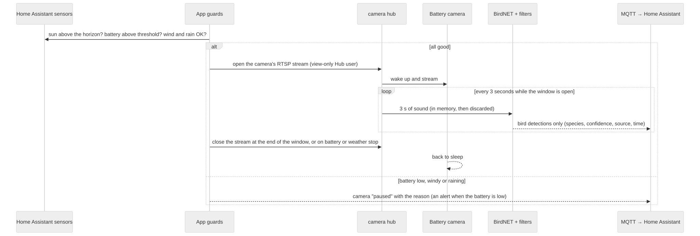







