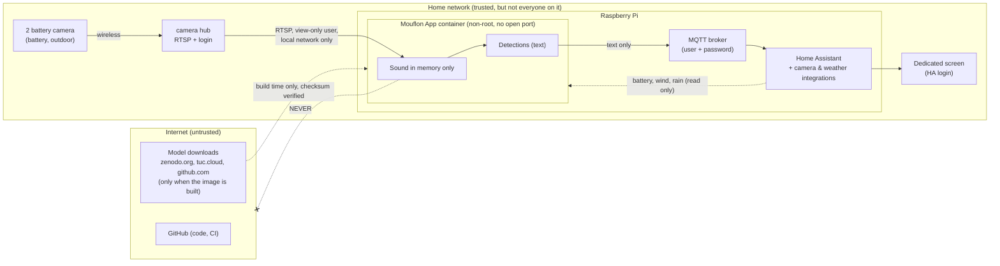

# Security — Mouflon Population

Owner: security-engineer. Last review: 2026-11-21 (sprint "takeover + architecture"), threat model updated the same day with the owner's answers (battery cameras via camera hub, Mosquitto, no audio kept).
How to report a problem: see [`../SECURITY.md`](../SECURITY.md).

This page has two parts: the **threat model** of the proposed design ([architecture](architecture/README.md)), and the **security review of the imported BirdNET-Analyzer code**. Risks are ranked Critical / High / Medium / Low. Anything High or Critical must be closed before the related part ships.

## 1. Threat model of the proposed design

### Firm rule: no audio is kept

The owner decided on 2026-11-21 that **no sound is ever kept**. Sound exists only in memory, 3 seconds at a time. It is never written to disk, logs, history, backups or messages, and never sent anywhere. The only stored data is the **detection log**: species, confidence, source and time. Any change to this rule needs a new decision by the owner and a new security review. Reviews treat any code path that writes or sends audio as a **Critical** finding.

### What we protect

| Asset | Why it matters | Sensitivity |
|---|---|---|
| Sound from the house cameras | Can contain conversations, voices of family and visitors, neighbours, street | **Very high** |
| Camera / camera hub addresses and passwords | The Hub's RTSP address carries a login that opens video and sound of both cameras | **Very high** |
| Camera battery (availability) | A drained battery camera stops recording security video too | Medium |
| Access to Home Assistant (MQTT login, tokens) | Home Assistant controls the house (locks, alarm, lights…) | **High** |
| Detection log (species, confidence, source, time) | Times of bird activity; weakly reveals routines | Low |
| The Raspberry Pi | Runs Home Assistant | High |

### Where the boundaries are

### Threats and what the design does about them

| # | Threat | Rank (if not mitigated) | Mitigation built into the design |
|---|---|---|---|
| T1 | Household sound leaves the house (cloud service, telemetry, bug) | Critical | All analysis on the Pi. No Cloudflare or other new cloud service (owner, 2026-11-21). Remote viewing only through the owner's existing Home Assistant Cloud, behind the owner's Home Assistant login, which can show detections but never sound (none exists); the App needs no internet at runtime (models baked into the image at build time); no cloud component (see architecture §3.8); a test checks the App works with the network cut |
| T2 | Sound is stored and later leaked (disk, backup, logs) | High | **Firm rule: no audio kept** (above). Sound is only in memory, 3 s at a time. Only the detection log is stored, so Home Assistant backups contain no sound. There are no bird clips. A test checks that no audio file is ever created |
| T3 | Conversations indoors are analysed | High | No indoor cameras in Home Assistant today (checked 2026-11-21); indoor sources excluded by default; each camera must be turned on explicitly in the App settings; human-sound classes from BirdNET are discarded inside the App, never published or stored |
| T4 | Camera / camera hub passwords leak (repo, logs, error messages, work files) | High | **As built:** the App reads the hub's RTSP stream directly (Home Assistant's built-in go2rtc cannot be used by an App), with a **separate view-only Hub user** the owner creates. He types its password into the App's settings themselves, as a masked password field stored by Home Assistant. The settings refuse a login written inside the URL. Every log line passes through a masker that removes URL logins and every registered password, including ffmpeg's error messages. Nothing is in Git (`.gitignore` covers `.env`, `secrets.yaml`, keys). Residual risk: the password is visible to processes inside the App's own container (ffmpeg command line), see finding P1 |
| T5 | Someone on the network reaches the App | High | No port opened on the Pi; the Detections page is reached only through Home Assistant Ingress (Home Assistant login required); page is read-only; the upstream desktop interface (finding H1) is not in the App |
| T6 | The App is used to control Home Assistant | High | **As built:** the MQTT login comes from the Supervisor (the Mosquitto App's per-App user), so no MQTT password is typed or stored by the owner for this App. Home Assistant access is the Supervisor token, used only for reading states, the home location and the MQTT details; the code has no service call. The App publishes only under `homeassistant/…/mouflon_population/…` and `mouflon/…` |
| T7 | Poisoned model or dependency (supply chain) | High | Models verified by checksum at build (finding M1); base images pinned by digest (M2); actions pinned by commit (done); Dependabot + Aikido + `pip-audit` in CI (done) |
| T8 | A malformed stream crashes or exploits the audio decoder (ffmpeg) | Medium | Streams only from the local network; ffmpeg kept up to date via image rebuilds; container runs as non-root with a read-only filesystem where possible |
| T9 | The App eats the Pi's CPU/RAM and Home Assistant becomes slow | Medium | Budgets in the architecture (≤ 1 GB RAM, ≤ 1 core); the App skips windows when it falls behind instead of queueing; Supervisor watchdog restarts it |
| T10 | Detection history reveals routines | Low | Stays local; retention limit (proposal: 12 months); no export by default |
| T11 | Sound from a public street or a neighbour's garden | Medium (legal/ethical) | Prefer cameras/microphones aimed at the owner's own garden (check what the "Camera 1" camera hears); this is a private household use. Not legal advice: if a camera faces the street, check Belgian camera and privacy rules before enabling its sound |
| T12 | **Battery drain** from waking the battery cameras for listening; a flat camera also stops its security recording (availability) | Medium | Listening from sunrise to sunset (owner's decision 2026-11-21, MOUL-39) instead of 24/7; unknown sun position = no listening. **Battery stop threshold** per camera (proposal: stop at 40 %, resume at 60 %, also stop if it drops more than 15 points a day), with an alert in Home Assistant. Wind and rain pause (weather station). Battery tracked during the proof of concept, and the source is swapped (dedicated microphone or mains camera) if the drain is too heavy. Fails safe: if the battery level cannot be read, the App does not listen |
| T13 | False or stale sensor values (weather cloud delay, battery not reported) let the guards make wrong decisions | Low | Guards treat missing or stale values (older than about 1 hour) as "do not listen" for the battery and "allowed" for the weather; the decision is logged in the camera status entity |

## 2. Security review of the imported code (BirdNET-Analyzer, upstream `897c6376`)

### What was run

| Check | Tool | Result |
|---|---|---|
| Dependency vulnerabilities (core + dev) | `pip-audit` 2.10.1 | No known vulnerabilities |
| Dependency vulnerabilities (all CI extras: embeddings, train, GUI tests) | `pip-audit` 2.10.1 | **42 known vulnerabilities in Pillow 12.3.0**, pulled in by the pinned `gradio==6.30.0` (see H2). **After the fix: no known vulnerabilities** |
| Secrets in the code | `detect-secrets` | 1 hit, false positive (a folder path in `tests/test_model_directory.py`). No real secret found |
| Static code scan | `bandit` | 2 "High" (SHA-1, false positive in context, fixed — L1), 5 Low |
| Risky patterns | manual search (`shell=True`, `eval`, `pickle`, `verify=False`, plain `http://`) | None found in `birdnet_analyzer/` |
| GitHub Actions | manual review | See M3, M4 (fixed) |
| Dockerfile | manual review | See M2 |
| Model downloads | reading the `birdnet` library 1.5.1 | See M1 |

### Findings

| ID | Rank | Finding | Status |
|---|---|---|---|
| H1 | **High** | The upstream desktop interface (Gradio) is started with `allowed_paths=["/"]` (whole disk on Windows): anyone who can reach its web server can download any file of the machine. | **Closed for the Pi (MOUL-14):** the App image contains no desktop interface. CI fails the build if `gradio`, `webview`, `tensorflow` or `birdnet_analyzer` can be imported in the image. The upstream GUI code still exists in the repository for desktop use (cleanup epic MOUL-10). |
| H2 | **High** | `gradio==6.30.0` (GUI and GUI-test extras) forces **Pillow 12.3.0**, which has 42 published vulnerabilities (memory corruption in image decoders, fixed in Pillow 13.0.0). | **Fixed**: gradio bumped to 6.32.0 (allows Pillow 13) and `pillow>=13.0.0` required in both extras. |
| M1 | Medium | BirdNET **2.4** model files (zenodo.org zips) are downloaded **without a checksum check** in the `birdnet` library. | **Closed (MOUL-16):** the image build checks all 56 model files against `app/models.lock.json` and fails on any difference. The fingerprints were recorded from a download on GitHub's servers on 2026-11-21 (trust on first use, see P3). |
| M2 | Medium | Dockerfile: base images by tag, not by digest; runs as **root**; installs the full TensorFlow | **Closed for the App image (MOUL-15):** base image pinned by digest, Python packages hash-checked, the program runs as an unprivileged user with no capabilities (checked in CI), no TensorFlow. The upstream `Dockerfile` at the repository root is no longer built by CI and is not shipped; it goes with the cleanup epic (MOUL-10). |
| M3 | Medium | Upstream release workflows would publish under the BirdNET team's names: PyPI (OIDC `id-token: write`), Windows Package Manager (token), Linux packages, docs to GitHub Pages (`contents: write`), image to GHCR (`packages: write`) | **Fixed**: those workflows removed; the Docker workflow only builds and tests (no publishing). |
| M4 | Medium | Workflows used actions by moving tags (`@v7`), no explicit token permissions on test/lint, checkout kept the Git token on disk | **Fixed**: every action pinned to a full commit SHA, `permissions: contents: read`, `persist-credentials: false`, Dependabot for actions. |
| M5 | Medium | No lock file: installs are not reproducible | **Closed for the App (MOUL-17):** `app/requirements.lock` with hashes for every package; `pip-audit` checks it in CI. |
| L1 | Low | SHA-1 used for cache keys in `analyze/resume.py` (bandit reports it as High; it is not a security use) | **Fixed**: marked `usedforsecurity=False`. |
| L2 | Low | `settings.py` calls `osascript` (macOS pop-up) via subprocess with an argument list, quotes escaped | Accepted (desktop only, not in the App). |
| L3 | Low | Two `assert` statements in runtime code (`model_utils.py`, `gui/utils.py`) are skipped in optimised Python | Accepted for now; replace when touching those files. |
| L4 | Low | No `SECURITY.md`; `.gitignore` did not cover `.env` / keys / local captures | **Fixed**. |
| L5 | Low | Test-data submodule was missing from the import (registered in `.gitmodules` but not in the tree) — tests could not run, so regressions would go unnoticed | **Fixed**: submodule registered at upstream's pinned commit `0545aad`. |
| P1 | Low | The hub password is passed to ffmpeg on its command line, so it is visible to processes inside the App's own container. | Accepted: the container runs only this App, as an unprivileged user; nothing else can see inside it. |
| P2 | Low | `run.sh` makes `/data/options.json` readable by the App's group so the unprivileged process can read its settings. | Accepted: `/data` is private to this App. |
| P3 | Low | Model fingerprints are trust-on-first-use (recorded from one download on GitHub's servers). | Accepted for the proof of concept; cross-check against the checksums Zenodo publishes when the models are next updated. |
| P4 | Low | `ffmpeg` comes from Debian's package repository without a version pin. | Accepted: Debian stable security updates are wanted; Dependabot rebuild proposals keep the base image current. |
| P6 | Medium | The App maps Home Assistant's media folder read-write (reference songs, MOUL-48). | **Accepted with mitigations:** writes only its own songs folder, reads nothing else, covered by a unit test; any change touching /media needs a security review. |
| P5 | Info | The App repository is **private**, so Home Assistant needs credentials to read it. | **Closed as decided (owner, 2026-11-21):** the repository stays private. Home Assistant reads it with a **fine-grained token the owner creates and pastes themselves**: only this repository, *Contents: read-only*, with an expiry. The token sits in the repository address stored by Home Assistant. It never appears in the repository, the work files or chats; the docs only show the `<TOKEN>` placeholder. If it leaks, someone can read the code (no secrets in it) until it expires or is deleted. |

**Aikido:** Aikido is connected to the GitHub repository; this review applied the same categories (dependencies, secrets, workflows, container). Any Aikido finding not listed here will be triaged in the next sprint; false positives are recorded in this page with the reason.

### Security review of the proof-of-concept build (2026-11-21)

Reviewed: every new file under `app/` and `tests/mouflon/`, `tests/e2e/`, and the workflows.
- **Firm no-audio rule:** sound only exists as an in-memory array inside one function call. There is no file write, no sound in logs, MQTT or the bird log. A test checks that the bird-log table has only the allowed columns, and the end-to-end test checks that the App writes no file other than the bird log.
- **Injection:** SQL uses parameters only. ffmpeg is started with an argument list, never through a shell. The preview page escapes every value.
- **Network:** no listening port. Outbound connections go only to the Supervisor, the MQTT broker and the configured RTSP sources.
- **Dependencies:** `pip-audit` on `app/requirements.lock` found no known vulnerabilities. No TensorFlow, Gradio or pywebview.
- **Secrets scan:** no secrets in the new files. The only password-like strings are throw-away values in tests and the end-to-end script.

**No Critical or High finding is open.** H1, M1, M2 (for the App) and M5 are closed. P1 to P4 are accepted Lows. P5 is closed as decided (private repository, read-only token).

**Review of 0.7.0 (confirmation cross-checks: Perch second opinion MOUL-54, Belgian GBIF statistics MOUL-55), 2026-11-23:**
- **Audio rule unchanged.** Perch receives the same 3-second window as an argument of one function call. There is no copy, file, log line, queue, message or database row for it. The window is dropped at the end of the analysis, as before. Enforced by:
  - a unit test: after a window is analysed, no array of its size is left in memory, and no published message mentions audio;
  - the existing tests and the e2e test: the App writes only its database files.
- **New build-time download (supply chain, Medium, mitigated).** The image build fetches Perch v2 (ONNX, 413 MB) and its labels from `huggingface.co`.
  - The URL holds a fixed repository revision.
  - Both files are pinned by SHA-256 in `app/models.lock.json`, and the existing verify step fails the build on any difference.
  - The same model file (identical SHA-256) is published by its original converter, which cross-checks its provenance.
  - Each file is checked against its fingerprint as soon as it is downloaded; a truncated or different file is deleted and fetched again (4 attempts), then the build stops. A CI build caught exactly this once (a download cut short), and the pin stopped it.
  - Never downloaded at runtime. No token or secret is involved.
- **No new Python dependency.** Perch runs on ONNX Runtime and SciPy, both already in the hash-checked lock and audited by `pip-audit` in CI. TensorFlow stays out of the image (CI check unchanged; the `birdnet` library's own Perch was rejected because it needs TensorFlow).
- **Model parsing (Low, accepted).** A crafted ONNX file could target ONNX Runtime's parser. The fingerprint pin makes a swapped file fail the build. ONNX Runtime is kept current through the lock.
- **Resource exhaustion (Low, mitigated).** Perch needs about 0.56–0.59 GB once loaded. Safeguards:
  - it checks free memory before loading;
  - it skips a run when the Pi is busy or another run is in progress;
  - it uses 2 threads;
  - it can be turned off (`second_opinion: false`).
  
  A skipped check never blocks confirmation.
- **GBIF statistics (Low).** Built in GitHub Actions from GBIF's public search API: no account, no secret, a generic User-Agent, read-only repository access. The data is public and aggregated at country level, with no coordinates and nothing about the home. A tampered file could only change which second check a bird needs; a person reviews the workflow output before committing it. The Pi never contacts GBIF.
- **Licences checked.**
  - **Perch v2:** Google DeepMind, Apache 2.0. The ONNX conversion and its hosting repository are also Apache 2.0. Redistribution in a self-built image is allowed with the licence notice, which the README gives. No non-commercial restriction.
  - **Perch labels:** scientific names (iNaturalist 2024 taxonomy) and FSD50K sound-class names. Names are facts; no restriction.
  - **GBIF data:** only records licensed CC0 1.0 or CC BY 4.0 are kept. GBIF filters on each record's own licence, and a unit test checks the filter in the manifest. Two datasets whose overall licence is CC BY-NC (iNaturalist research-grade, Birda) contribute only records their observers licensed CC0 or CC BY: about 0.3 % of the 7.45 million records. The bundle therefore carries no non-commercial clause. CC BY requires attribution: every dataset is listed in `app/crosscheck/manifest.json` with its title, licence, DOI and citation, and the README credits GBIF and the main publishers.
  - **No single GBIF download DOI.** A download DOI needs a GBIF account. Each dataset is cited with its own DOI instead. Getting a download DOI later is optional and up to the owner.
- **"Validated" observations.** GBIF's search API ignores the validation-status filter (tested). Records come from curated sources (portal records with automatic and manual validation, monitoring schemes, eBird with regional reviewers, tracking studies). Accepted: the check only decides which second check a bird needs.
- **Aikido.** No new dependency and no new secret. The new workflow is read-only (`contents: read`) and its actions are pinned by commit SHA. Any Aikido finding raised on this push is triaged in the next sprint and recorded here.
- **No Critical or High finding.**

**Pre-sharing inspection (0.6.1, MOUL-49, 2026-11-23), before the code is shared with one more reader:**
- **Secrets, whole history** (all commits of `staging`, `main` and `library-build`): no token, password, API key, private key, Home Assistant token, or stream address with a real login. Only test fakes and documentation addresses. No personal email address in any file or commit message; commit identities are generic bot addresses.
- **Wikimedia contact:** never written in a file. While it was briefly a repository variable, the run logs show it was empty; since then it is a masked secret. It is optional; a fork sets its own (see `docs/install.md` §6).
- **Personal details:** older internal history used household-specific wording, now replaced by generic wording (rule 10). This shareable copy is a fresh snapshot with no history, and the internal work files are left out.
- **Access for a collaborator:** read access is enough to read and run the code. Write access would let someone push to `staging`, which the Pi installs from and which runs the workflows holding the repository secrets: grant it only with branch protection and a review rule.
- **Workflows:** actions pinned by commit hash, read-only by default, write only in the two library "save" jobs (to `library-build`, running no project code), no `pull_request_target`. `pip-audit` now also covers the two tool locks.
- **Aikido:** findings are not visible from the team's session; none is recorded as open.
- No Critical or High finding.

**Review of 0.6.0 (full bird library in the App, MOUL-42, MOUL-44), 2026-11-23:**
- **What ships:** 164 Home Assistant renditions (about 6 MB; at most 480 px, JPEG) of public-domain plates from Wikimedia Commons, and `app/library/catalogue.json` with a credit per drawing and the IUCN category (Wikidata, CC0). 163 come from the full build saved on `library-build/build/` (owner's approval, 2026-11-23); the hoopoe comes from the already-reviewed demo pack (`--extra`), because it is not on the regional list. No song is bundled (xeno-canto now needs a key the owner has not created). Every file is still public domain; the Commons page of each plate is linked from the manifest and the contact sheet.
- **Same path as before, no new access.** The App still reads only files inside its image; the Pi fetches nothing from the internet and no audio is touched (rule 3 unchanged). No new dependency in the App or the pipeline. The only workflow change prints the App image size as a notice on the run (no secret, no network).
- **Crop boxes** for the 33 multi-species plates are tied to the exact Commons file, so a different plate never gets a wrong box; the installer refuses any multi-species plate without a reviewed box. The installer's `--extra` only fills species with no drawing; it never replaces a full-build drawing.
- **Integrity:** each installed file's SHA-256 is recorded in `docs/illustrations/manifest.json` (`sha256_ha`); the build ran in GitHub Actions from hash-pinned Pillow and numpy, and the images were decoded again locally by the same Pillow version for review.
- **Rule 10:** the contact sheet, coverage report and manifest hold only species, plate titles, Commons links and credits; nothing about the household. The Wikimedia contact is not in any of them.
- **Accepted Low:** some plates are weak name matches or show a close relative (listed in `coverage.md`); this is a content-accuracy issue, not a security one, and the owner tracks a second review in a separate Jira story.
- **Aikido:** not visible from the development sandbox (no Aikido check or code-scanning alert on GitHub). No dependency changed, so no new advisory applies. The owner checks Aikido's dashboard; any recommendation is applied or recorded here.
- No Critical or High finding.

**Review of 0.5.2 (demo starter pack, rarity on/off sensors), 2026-11-22:**
- **What ships:** 18 Home Assistant renditions (about 0.8 MB) of public-domain plates from Wikimedia Commons, plus `app/library/catalogue.json` with credits. They come from the "demo-pack" job, saved on `library-build/demo-pack/` and installed with `tools/illustrations/install.py`, the same path the full library will take. They are reviewed on the mini contact sheet `docs/illustrations/contact-sheet.html`. The Pi still fetches nothing from the internet.
- **Build job:** separate jobs with their own concurrency group, so they cannot cancel or delay the full build. Pillow and numpy are installed with hashes (`requirements-pack.lock`). The contact comes from the secret, goes only to Wikimedia and is never printed. The write job writes only `demo-pack/` on `library-build` and never force-pushes.
- **Crop boxes** are tied to the exact Commons file, so a different plate never gets a wrong crop.
- **Rarity sensors:** three binary sensors read the existing last-bird message. They add no data and no topic.
- No Critical or High finding.

**Review of 0.5.3 (aged paper, looser crops, organic edges, French placeholder, dashboard stacks), 2026-11-22:**
- **No new dependency, no new network access.** `vintage.py` uses Pillow only (already pinned in `app/requirements.lock`). It processes only the drawings bundled in the App image; unreadable bytes are passed through unchanged. The "Gravure à venir" card is drawn locally with a bundled OFL font (the bundled English picture is removed). The Pi still fetches nothing and no audio is touched (rule 3 unchanged).
- **Pipeline:** the build step imports `vintage.py` from the same checkout (no download). Crop boxes stay tied to the exact Commons file; captions are blanked only inside the reviewed boxes.
- **Workflow change (demo pack):** the demo-pack job now also keeps its original plates (about 2.4 MB, 18 public-domain files) in its artifact, so the save job writes them to `library-build/demo-pack/originals/`. Reason: the development sandbox cannot download run artifacts, and the crops had to be checked against the whole plates. Same branch guard as before (only `library-build`, no force-push, never `staging` or `main`). Accepted Low: if the demo-pack save and the full build's save ever pushed at the same moment, one push would be refused and fail visibly; nothing is overwritten. The running full build was not touched.
- **Dashboard reference copy:** standard cards only (vertical-stack, picture-entity, markdown with `text_only`); the Mushroom chips were already reviewed. The markdown shows the App's own attributes (BirdNET names, times); Home Assistant sanitises markdown HTML.
- **Rule 10:** docs, tests and sample data stay generic.
- **Aikido:** its findings are not visible from the development sandbox (no Aikido check run or code-scanning alert on GitHub). The owner checks Aikido's dashboard; any recommendation is applied or recorded here as a false positive.
- No Critical or High finding.

**Review of the resilient full library build (MOUL-43, 2026-11-22):** retries with backoff, "failed, retry later" status, stop 15 minutes before the time limit, plate cache between runs.
- **Contact still only to Wikimedia, never printed.** Retries reuse the same request, so the header rules are unchanged (`agent_for`). Error messages and the coverage report carry only a short reason such as "HTTP 429 after 6 attempts": no URL, header or User-Agent. A test runs the download with a contact set and checks it is not printed.
- **Gentle on Wikimedia.** At most 6 attempts per request, waits from 15 s doubling to 10 min, Retry-After honoured, a slower pace after each busy answer, and no more requests if asked to wait over 15 min. One full build at a time (unchanged concurrency group). The cache means a re-run fetches only what is missing, which lowers the load further.
- **Plate cache (new, Low, accepted).** `actions/cache/restore` and `actions/cache/save`, pinned to the same commit SHA as the cache action used in CI, keep `work/originals` between full builds. GitHub scopes caches to the branch (`staging`, and the default branch for reads), so only workflows of this private repository can write them. Each entry is reused only if its file's SHA-256 matches and Commons still reports the same SHA-1 for the original; otherwise it is downloaded again. Residual risk: someone able to push workflows to the repository could plant a public-domain-looking image; the same person could already change the pipeline. Images are decoded by hash-pinned Pillow in a throw-away runner, and everything is reviewed on the contact sheet before the owner approves it.
- **Deadline.** The stop time is computed by the workflow from the job's start; it holds no secret. The save job is unchanged (no project code, only `library-build`, keeps `demo-pack/`, never force-pushes).
- **Aikido:** not visible from the development sandbox; no new dependency was added (standard library only in the pipeline change). The owner checks Aikido's dashboard; any recommendation is applied or recorded here.
- No Critical or High finding.

**Contact handling for the library downloads (owner's decisions, 2026-11-22).** Wikimedia asks automated clients for a contact in the User-Agent. Rule 10 applies: the contact itself appears nowhere in the repository.
- **First full build: temporary contact.** The owner set a personal contact in GitHub's repository settings for the first full build only. After that build is saved on `library-build`, the owner deletes it.
- **Never printed.** The contact goes only into the request header, and only to Wikimedia hosts; GBIF and xeno-canto get the generic User-Agent. The pipeline prints "contact set" instead of the User-Agent, and its progress lines show only species names and counts. A test checks the pipeline never prints the full User-Agent.
- **Secret, not variable (finding, Medium).** GitHub shows a step's environment in the run log, and hides only values stored as *secrets*. A value stored as a repository *variable* would therefore appear once, in clear, in the build step's log (visible to anyone with access to the private repository). So the workflow reads only the `WIKIMEDIA_CONTACT` secret. Until the owner stores the contact as a secret, builds run with the generic User-Agent. The owner asked to keep the variable; the team asked the owner to confirm, given this.
- **Later updates: slow mode** (follow-up story). Low request rate, backoff on 429, small batches, and only missing or changed items. The User-Agent contact becomes the private repository's GitHub address instead of a personal one (Wikimedia's policy accepts a URL), so no personal data is needed.
- Only the build step receives the contact; the write-enabled save-for-review job does not. The old run log (before this change) was checked: it held no contact.

**Review of MOUL-56 rework, French text and MOUL-57 (live screen preview), version 0.5.0:**
- **Less on the frame.** The e-ink screen no longer shows the camera or source name (owner's decision); a test checks that no drawn text contains it. Home Assistant entities and the bird log keep the source, as before.
- **French text** is a display change only: entity names, statuses and labels come from one module (`i18n.py`). Entity ids are pinned with `default_entity_id`, so automations cannot silently break when the language changes. No new data, permission or destination.
- **VS Code task (developer computer only, never the Pi).**
  - `tools/screen_preview/run.sh` creates `.venv-screen` (ignored by Git) and installs **Pillow only**, with `--require-hashes`, `--only-binary=:all:` (no build scripts run) and `--no-deps`, from `tools/screen_preview/requirements.lock` (same version as the App). That is its only network access (PyPI).
  - The watcher polls file dates and runs the renderer in a fresh local process. It opens no port and calls nothing else.
  - The preview page is self-contained: images are embedded, no external script, font or request (a test checks there is no `http` address in it). It keeps the selected view in the browser's local storage only.
  - Live Preview (Microsoft, `ms-vscode.live-server`) is pinned to `127.0.0.1` in the committed workspace settings, so the page is not reachable from the network. Like most VS Code extensions it follows VS Code's own telemetry setting; turn telemetry off in VS Code if wanted. This is developer tooling, not part of the product, so the product's no-telemetry rule is unaffected.
  - The task runs only after the person trusts the workspace (VS Code Workspace Trust).
- **Aikido-style checks:** no new dependency in the App image; the preview's one dependency is pinned with hashes. No secret anywhere.
- No Critical or High finding. **Low (accepted):** the task trusts PyPI at first run, limited by the hash pin.

**Review of MOUL-53 (provisional birds) and MOUL-52 (delay), version 0.4.0:**
- **Provisional birds** are shown before confirmation, but no rarity pill and no `rare_bird` notification fire until confirmation. Withdrawn birds are stored in the analytics table only as `withdrawn` and are never counted as confirmed. The bird log still holds only confirmed detections.
- **Delay measurement** reads the last-bird state back through the existing read-only Supervisor access (no new permission) and publishes timing figures only.
- No new finding.

**Review of MOUL-51 (analytics table) and MOUL-56 (e-ink demo screen), version 0.3.0:**
- **Analytics data stays on the Pi:**
  - text only (species, confidence, source, time, rarity, status, versions);
  - kept in the App's data folder and included in Home Assistant's App backups;
  - no network use, and no off-Pi copy, which would need a new owner decision and a security review.
- **CSV export:** written only into the App's own folder in the media folder (the existing `media:rw` mapping, finding P6), on demand from a Home Assistant button. Anyone with Home Assistant administrator access, or file access to the media folder, can read the exports: acceptable for a household, and documented.
- **Integrity:** demo and test detections can never enter the analytics table (code paths and tests). Retention cannot purge it.
- **Screen:** rendered locally with bundled OFL fonts (licences included); published as MQTT image entities. No new permission and no network.
- **New dependency:** Pillow 13.0.0, hash-locked; `pip-audit` reports no known vulnerabilities.
- No new finding.

**Review of the "save-for-review" job (owner's decision, 2026-11-22):** the "Bird illustrations" workflow may write the built library to a separate `library-build` branch, so the team can review it. Checks:
- **Narrowest permission:** the workflow default stays `contents: read`. Only the small `save-for-review` job has `contents: write`. It checks out no project code and runs none; it only downloads the run's artifact and commits it.
- **One branch only:** the target branch name is fixed to `library-build` and checked before pushing. The job never pushes to `main` or `staging`, never force-pushes, and builds the branch history commit by commit.
- **No workflow chain:** pushes made with the default `GITHUB_TOKEN` do not trigger other workflows. The illustration workflow itself only triggers on `staging`.
- **No extra secret** in that job: only the default `GITHUB_TOKEN`, which GitHub masks in logs. The build job may read an optional xeno-canto API key and an optional Wikimedia contact variable, both set by the owner only if wanted.
- **Pinned actions:** checkout, setup-python, upload-artifact, download-artifact and cache (restore/save, since MOUL-43) are all pinned to commit SHAs.
- **Gate:** nothing from `library-build` goes into the App on `staging` until the owner approves the contact sheet.
- Verdict: acceptable, Low residual risk (a compromised pinned action could write to that one branch).

**Review of the bird library, rarity and songs (MOUL-42/45/47/48, version 0.2.0, 2026-11-22):**
- **Licences.**
  - Plates: Commons files with a public-domain tag only (Naumann 1896–1905, Dresser 1871–96). Re-hosted NC scans and aggregator copies are excluded.
  - IUCN status: from Wikidata (CC0); no IUCN data files, whose terms restrict redistribution.
  - Songs: xeno-canto CC BY / BY-SA preferred, BY-NC(-SA) accepted for this personal, non-commercial project, ND excluded (clips are trimmed and normalised). Recordist, XC number and licence are kept per clip and shown as the credit.
- **No runtime internet.** Everything is fetched by the GitHub Actions workflow with read-only repository access, and bundled into the image. The Pi fetches nothing.
- **Reference songs are not garden audio.** The firm no-audio rule is unchanged: no camera sound is kept. The bundled reference clips of each species are a separate thing, and the docs and AGENTS.md say so explicitly.
- **New permission P6 (Medium, accepted with mitigations):** the App maps Home Assistant's media folder read-write to install the songs. It writes only `/media/mouflon_population/songs/*.mp3` copied from the image. It never lists, reads or deletes anything else, and a unit test checks that only library files end up there. Other media (for example camera recordings) could in principle be reached by the App process, so any code touching `/media` needs a security review.
- **Images** reach Home Assistant as MQTT image entities, served by Home Assistant behind its own login. No port, no file access.
- **Rarity** uses only the local bird log, the geo model and bundled IUCN data. The confirmation rule keeps unconfirmed rare candidates out of the bird log.
- **Workflow permissions:** a proposal to let the library workflow push to a review branch (contents: write) was refused by the permission system and was not pursued. The workflow stays read-only.
- **Carousel card:** not installed. Installing any frontend card needs the owner's yes; pin a version and read its changelog first.
- No Critical or High finding.

**Review of MOUL-49 (information minimisation, 2026-11-22, version 0.1.4), led by the security engineer:**
- **In-Home-Assistant docs slimmed.** `app/DOCS.md`, which every Home Assistant administrator can read, now holds only the household user guide. Installation, the token procedure, the repository address, the hub set-up and security internals moved to `docs/install.md` in the private repository.
- **App listing.** The repository address was removed from the App's `config.yaml`. Example settings use generic names and a documentation-range address (192.0.2.x).
- **Repository docs made generic.** Device makes, models and names, the hardware details and Home Assistant version of the household, the Jira site and personal names are replaced by generic wording ("battery cameras behind a hub", "a Raspberry Pi", "Camera 1", "Jira project MOUL", "the owner"). The threat model and findings are unchanged in substance.
- **New hard rule** in `AGENTS.md` (rule 10): docs describe the product generically.
- **Residual:** older internal commits still contain the previous wording; the shareable copy carries no history (accepted, Low).
- The team-agent definitions in `.claude/agents/` come from the separate product-team repository and are not product documentation; they are out of scope here.

**Review of MOUL-41 (demo mode, 2026-11-21):**
- **Nothing new leaves the Pi.** Demo mode uses no audio and no model. Since 0.1.3 (MOUL-50) it reads no Home Assistant entity at all; it publishes to the same local MQTT topics as before. It reaches no new network destination and adds no new secret.
- **Fake data cannot be taken for real.** Source names are prefixed "Démo", every payload carries `demo: true`, a "Demo mode" binary sensor exists, and the start-up log says so.
- **Integrity of the real log.** Demo detections are kept in memory and never written to the bird log, which a test proves. The settings refuse demo mode together with test mode or enabled audio sources.
- No new finding.

**Review of MOUL-40 (2026-11-21):** test mode now switches the species filter off, and a new log line names the birds the filter drops. Bird names are not sensitive and no audio is involved. A new optional setting for runs outside Home Assistant (`MOUFLON_HOME_LATITUDE`/`LONGITUDE`, used by CI) holds no secret. No new finding.

**Review of MOUL-39 (daylight listening, 2026-11-21):** the App reads one more entity (`sun.sun`), through the same read-only access. If it cannot read it, it does not listen (fail-safe for the battery). Longer listening raises the battery-drain risk (T12). The battery guard is unchanged and still applies in every mode, and its pauses are reported as "paused: battery …". No new finding.
